<div align="center">

<picture>
  <source media="(prefers-color-scheme: dark)" srcset="web/public/images/logo-white.png">
  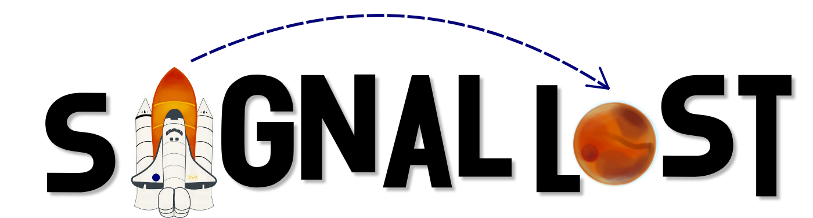
</picture>

### *The robots have gone silent. Can you bring them back?*

An educational space game for kids, built for the **NASA Space Apps Challenge 2026**  
Challenge: **Junior Astronaut Mission Trainer** · Local event: **Phoenix, Arizona**

<br>

[](https://lalocarrito.github.io/signal-lost/)
[](https://lalocarrito.github.io/signal-lost/)
[](https://www.spaceappschallenge.org/2026/find-a-team/2isi/)

<br>

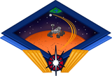
&nbsp;&nbsp;&nbsp;


</div>

---

## 🛰️ About the mission

You are a young space specialist on a mission far from Earth. On the **Moon** and on **Mars**, our robot explorers have stopped talking. Your job: **fix them, keep your base alive, and make every bit of energy count.**

> *Every choice matters, because up here, nothing is free.*

Our challenge was to help kids train like real astronauts. So we built a game where you can't just press a button and win: **you plan, you repair, you wait for messages from Earth, and you make your own choices.**

### What kids practice

| | |
|---|---|
| 🟠 **Planning energy, air and food** | 🔵 **Fixing problems step by step** |
| 🟢 **Reading real space data** | 🔴 **Thinking alone when Earth is far away** |

---

## 🤖 Meet the robots

Every robot in the game is inspired by a **real** explorer.

<div align="center">

| 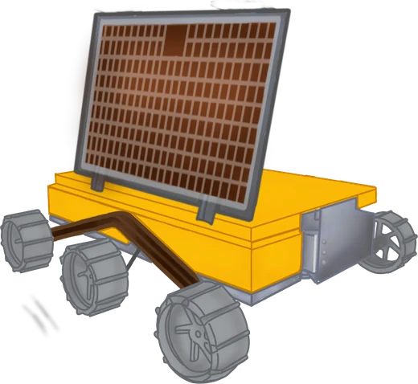 | 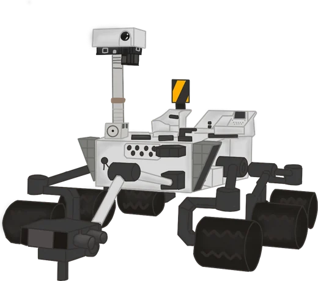 | 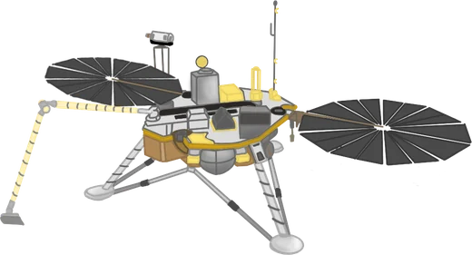 | 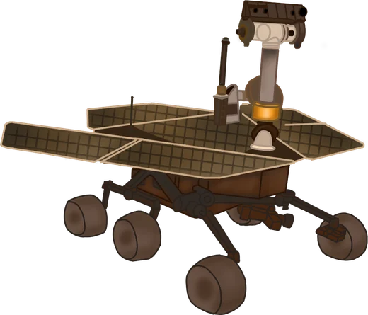 |
|:---:|:---:|:---:|:---:|
| **Pragyan** | **Curiosity** | **Phoenix** | **Opportunity** |
| 🌙 The Moon | 🔴 Mars · Gale Crater | 🔴 Mars · North pole | 🔴 Mars |

</div>

---

## 📡 Real data from space

| | |
|---|---|
| ⏱️ **Message delay** | A message from Earth takes **1.3 seconds** to reach the Moon, but **3 to 22 minutes** to reach Mars. That's why Sam's tips arrive late in the game. |
| ☀️ **Solar storms** | The storms in the game come from real records in **NASA DONKI**, including the May 2024 storms, the strongest to hit Earth in about 20 years. |
| ☢️ **Radiation on Mars** | Danger levels are based on readings from **RAD**, the radiation detector on the Curiosity rover (Mars Science Laboratory). |

**Sources:** NASA DONKI (Space Weather Database Of Notifications, Knowledge, Information) · Mars Science Laboratory RAD data · NASA mission pages for Curiosity, Phoenix and Opportunity · ISRO Chandrayaan-3 mission for Pragyan.

---

## 🏛️ Arizona Science Center

We were the lucky team that got to spend the challenge at the **Arizona Science Center**. There we developed our idea and shared our process with the community: we answered visitors' questions and invited kids to join science competitions, hoping to inspire them to step into these fields.

<div align="center">

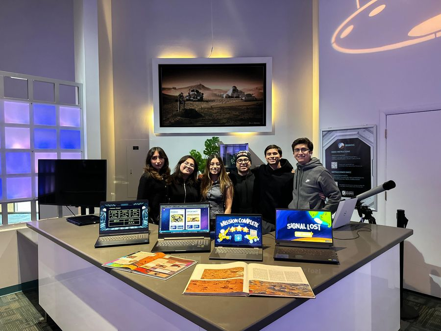
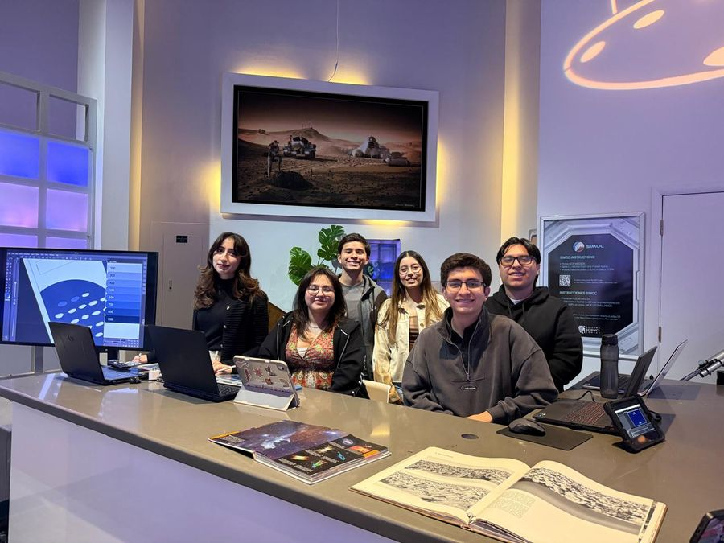

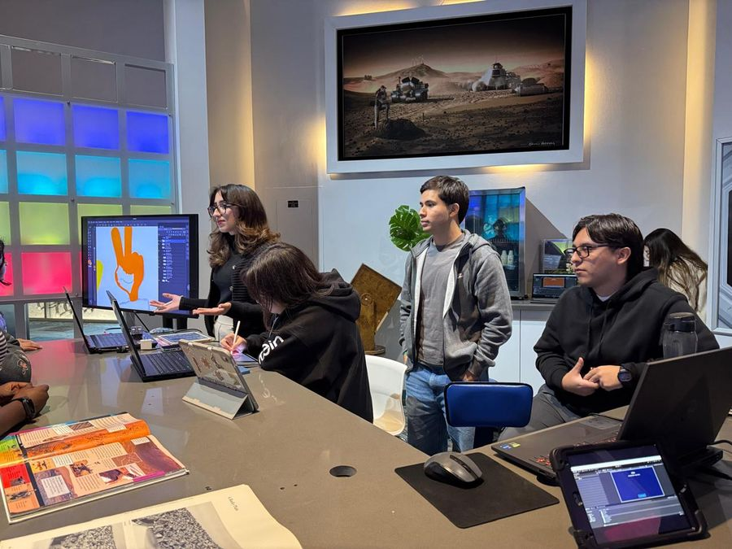
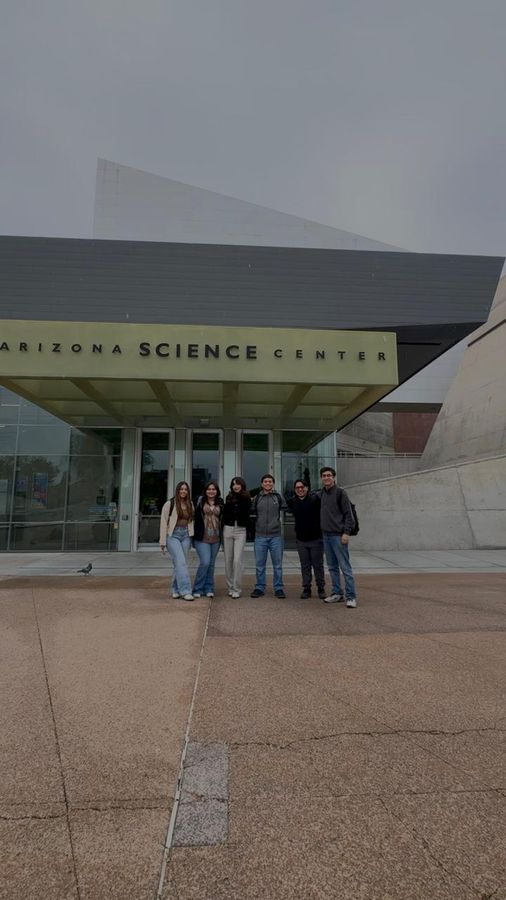
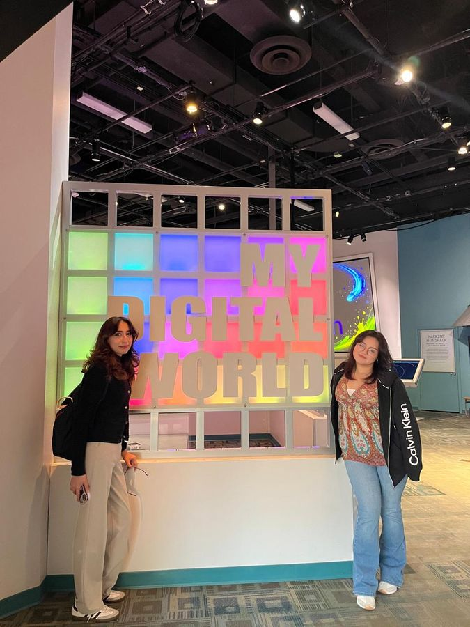

### ✨ *If you can dream it, you can build it!* ✨

</div>

---

## 🛠️ Built with

<div align="center">

&nbsp;&nbsp;&nbsp;
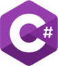&nbsp;&nbsp;&nbsp;
&nbsp;&nbsp;&nbsp;


**Unity** · **C#** · **Unity Version Control** · **Astro** · **Canva** · **NASA Open Data**

</div>

---

## 📁 Project structure

```
signal-lost/
├── web/                  ← website source code (Astro)
│   ├── src/
│   │   ├── pages/        ← Home, Mission, Data, About
│   │   ├── components/   ← Nav, Footer, Sky
│   │   ├── data/         ← team.js, robots.js
│   │   └── styles/       ← global.css
│   └── public/
│       ├── images/       ← art, photos, logos
│       ├── fonts/
│       └── play/         ← Unity WebGL build goes here
├── docs/                 ← BUILT website, published by GitHub Pages (don't edit by hand)
└── README.md
```

---

## 💻 Run the website locally

**Requirements:** [Node.js](https://nodejs.org/) 18 or newer.

```bash
cd web
npm install        # only the first time
npm run dev        # http://localhost:4321/signal-lost/
```

### Publish changes

```bash
cd web
npm run build      # rebuilds the docs/ folder
```

Then commit **both** `web/` and `docs/`, push, and merge into `main`. GitHub Pages (branch `main`, folder `/docs`) updates the site in 1–2 minutes.

> ⚠️ `npm run build` **deletes and recreates** `docs/`. Never put files inside `docs/` by hand.

### Add the Unity WebGL build

1. In Unity: **File → Build Settings → WebGL**.
2. In **Player Settings → Publishing Settings**, set **Compression Format** to `Disabled`, or keep `Gzip`/`Brotli` and enable **Decompression Fallback**. GitHub Pages doesn't send the headers that compressed builds need.
3. Copy the **contents** of the build folder (`index.html`, `Build/`, `TemplateData/`) into **`web/public/play/`**.
4. Run `npm run build`, then commit and push. No single file can be larger than 100 MB.

---

## 👩‍🚀 The team · 2ISI

<div align="center">

| 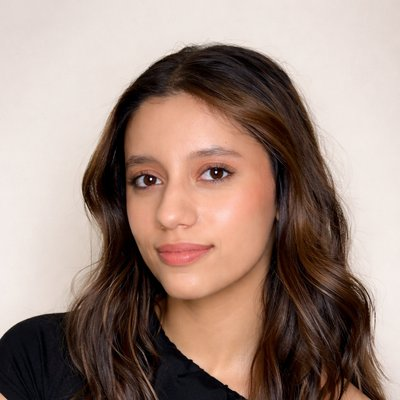 | 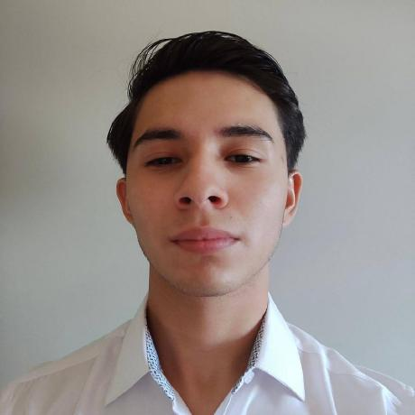 | 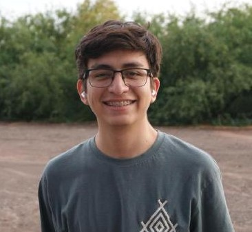 |
|:---:|:---:|:---:|
| **Gloria Sánchez** | **Antuan Carpio** | **Josué Martínez** |
| Web page, UI design and the Moon tutorial | Base hub, API DONKI, API RadLab OSDR, audio and resource system | Core systems, Mission A, WebGL, dialogs and version control |
| [GitHub](https://github.com/Gloria-Sanchez9) · [LinkedIn](https://www.linkedin.com/in/gloria-s%C3%A1nchezz/) | [GitHub](https://github.com/antuancarpio) · [LinkedIn](https://www.linkedin.com/in/antuancarpio/) | [GitHub](https://github.com/Lalocarrito) · [LinkedIn](https://www.linkedin.com/in/josu%C3%A9-mart%C3%ADnez-b37128380/) |

|  | 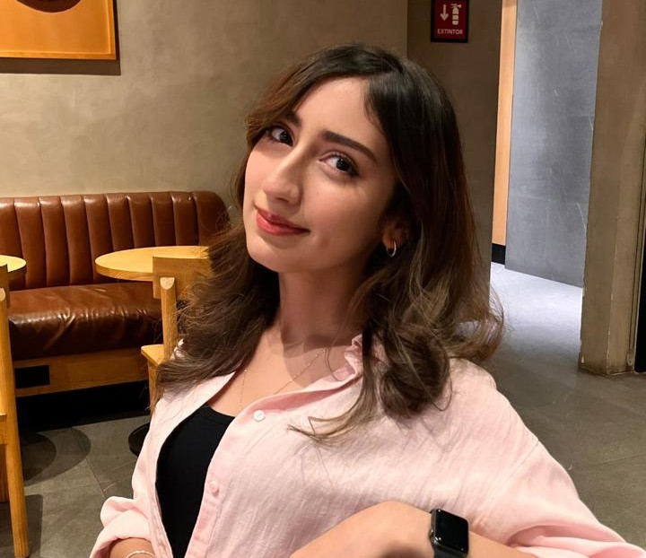 |  |
|:---:|:---:|:---:|
| **Santiago Pérez** | **Celeste Román** | **Mia Valenzuela** |
| Pause menu, Game over, Mission B and Mission C | Art, visual identity and screens | Characters, narrative and art |
| [GitHub](https://github.com/santiperez19) · [LinkedIn](https://www.linkedin.com/in/sperezcanez/) | [GitHub](https://github.com/mceless3) · [LinkedIn](https://www.linkedin.com/in/maria-ruiz-a29a9037b/) | [GitHub](https://github.com/miaren125) · [LinkedIn](https://www.linkedin.com/in/miareneeval/) |

🇲🇽 Software Engineering students at **Universidad de Sonora**

</div>

---

<div align="center">

Made with 🧡 by the **Signal Lost** team for the **NASA Space Apps Challenge 2026**  
<sub>Not an official NASA product. Robot drawings and game art were made by our team.</sub>

</div>